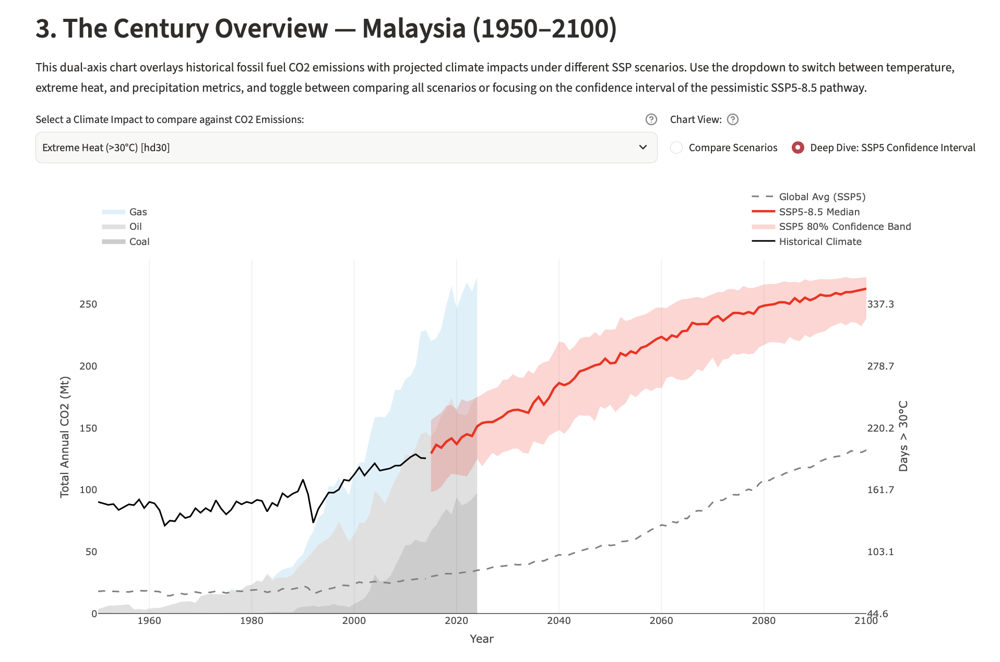

# Global Climate Dashboard

Explore how CO₂ emissions, climate projections, and coastal population exposure vary across countries and over time. Built with Python, Streamlit, pandas, and Plotly.

I built this dashboard for a data visualisation coursework project, combining five datasets into an interactive map, country comparisons, and climate scenario charts.

**[Open the live dashboard](https://global-climate-dashboard-cmc9tvw2jmgy5kqhxltmqp.streamlit.app/)**

## Dashboard preview


*Global overview showing 2022 CO₂ emissions by country.*

## What you can explore

- **Explore seven map metrics.** Move through time with the year slider or timeline animation. Choose a country or click it on the map to update the indicators and trend charts.
- **Compare countries and regions.** See the top 10 countries for the selected metric and year, and compare trends across ASEAN in a heatmap.
- **Compare climate scenarios.** Use the Century Overview to explore temperature, extreme heat, and maximum one-day precipitation under three SSP pathways through 2100.

## Key findings

- **Emissions rankings depend on the metric.** In 2022, China led the dashboard’s total CO₂ ranking at **11.7 Gt**, and Qatar led the per-capita ranking at **37.9 tonnes per person**.
- **Malaysia’s projected extreme heat varies by scenario.** In 2100, the median projection is **247 days above 30°C** under SSP1-2.6, **301 days** under SSP2-4.5, and **352 days** under SSP5-8.5.

The [findings and discussion](docs/findings.md) explains how to reproduce these comparisons and how to interpret the coastal exposure chart.

## Run locally

From the repository root, set up the environment with Python 3.12.

```sh
python3.12 -m venv .venv
source .venv/bin/activate
python -m pip install -r requirements.txt
python -m streamlit run app.py
```

Streamlit prints the dashboard URL in the terminal. The app reads the CSVs bundled in `data/`.

## Try it

1. Select **Malaysia** under **Focus Region** and scroll to **Century Overview**.
2. Choose **Extreme Heat** and use **Compare Scenarios** to see how the three pathways differ.
3. Switch to **Deep Dive** to see the median and 10th–90th percentile band for SSP5-8.5.



## How to read the data

- **Climate timeline.** Historical climate data covers 1950–2014. Scenario projections cover 2015–2100.
- **Coastal exposure.** The dashboard uses the estimated population in coastal areas at or below 5 metres in elevation as an indicator of potential exposure. It labels later values that reuse the 2015 estimate. Percentages use the total population for the selected year. [World Bank indicator definition](https://databank.worldbank.org/metadataglossary/world-development-indicators/series/EN.POP.EL5M.ZS)

## Data sources

- CO₂ emissions and population from [Our World in Data](https://ourworldindata.org/co2-and-greenhouse-gas-emissions).
- Historical climate data and projections from the [World Bank Climate Change Knowledge Portal](https://climateknowledgeportal.worldbank.org/).
- Coastal exposure estimates derived from [World Bank development indicators](https://data.worldbank.org/).
- Sea level observations from the [EPA sea level dataset](https://github.com/datasets/sea-level-rise).

## Data preparation

`download_climate_data.py` fetches historical and projected climate data. `download_coastal_and_sea_level_data.py` prepares the coastal exposure and sea level datasets. These scripts use external sources and overwrite their corresponding CSVs when run. The bundled snapshots are ready for use with the dashboard.
