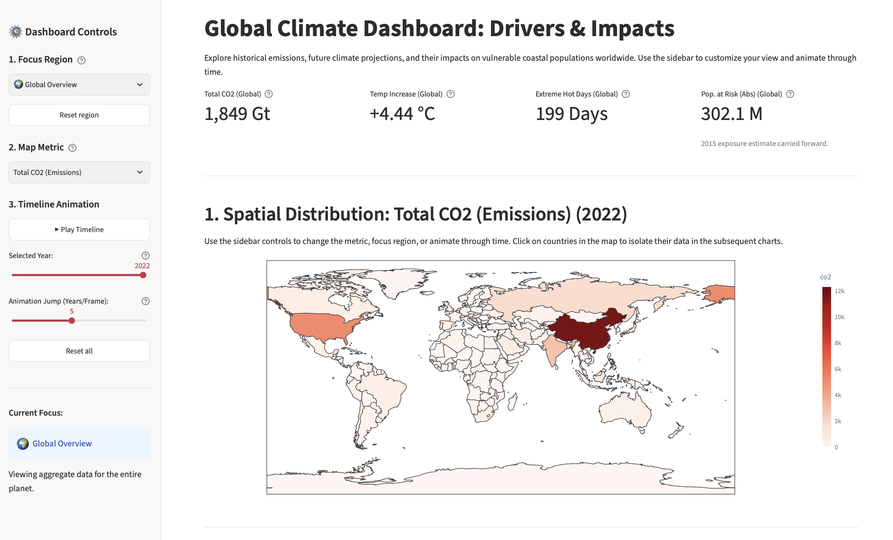

# Global Climate Dashboard

An interactive Streamlit dashboard for exploring CO₂ emissions, climate projections, and population exposure in low-elevation coastal areas. Use the map and timeline to compare countries, explore trends across ASEAN, and switch between future emissions scenarios.

## Dashboard preview



*Global overview showing 2022 CO₂ emissions by country.*

## Run locally

From the repository root, set up the environment with Python 3.12.

```sh
python3.12 -m venv .venv
source .venv/bin/activate
python -m pip install -r requirements.txt
python -m streamlit run app.py
```

Streamlit prints the dashboard URL in the terminal. The app reads the CSVs bundled in `data/`.

## Data sources

- CO₂ emissions and population from [Our World in Data](https://ourworldindata.org/co2-and-greenhouse-gas-emissions).
- Historical climate data and projections from the [World Bank Climate Change Knowledge Portal](https://climateknowledgeportal.worldbank.org/).
- Coastal exposure estimates derived from [World Bank development indicators](https://data.worldbank.org/).
- Sea level observations from the [EPA sea level dataset](https://github.com/datasets/sea-level-rise).

## Data preparation

`download_climate_data.py` fetches historical and projected climate data. `download_coastal_and_sea_level_data.py` prepares the coastal exposure and sea level datasets. These scripts use external sources and overwrite their corresponding CSVs when run. The bundled snapshots are ready for use with the dashboard.
